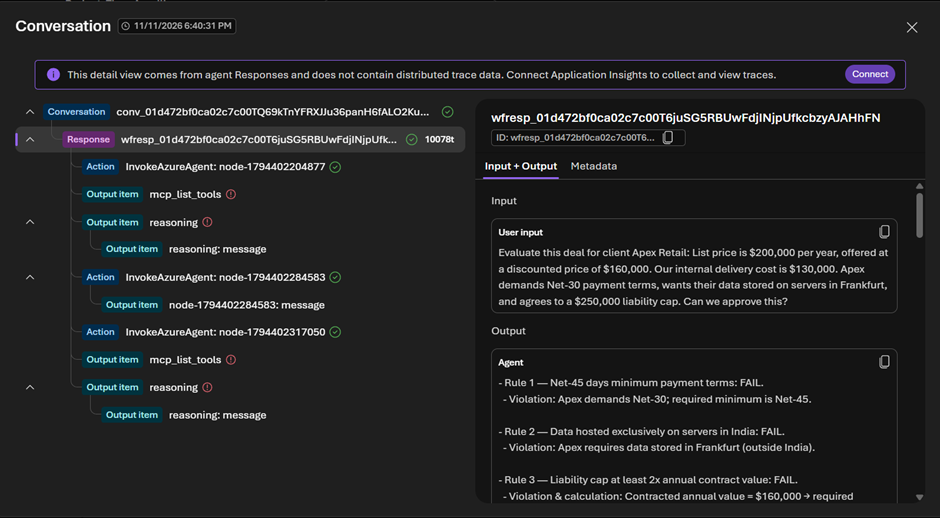

# ⚖️ Autonomous Corporate Deal-Desk & Vendor Risk Committee
**A Multi-Agent Orchestration System Built on Microsoft Foundry (`gpt-5-mini`)**

## 📌 Executive Summary
Enterprise deal approvals often stall in bottlenecks between Legal Compliance, Finance, and Executive Deal-Desk teams. This project implements an automated **3-Agent Sequential Triage System** in **Microsoft Foundry** that evaluates incoming vendor contracts and commercial proposals in seconds—enforcing corporate legal policies via **File Search (RAG)** and verifying profit margins via **Python Code Interpreter** at a fraction of a cent per run.

---

## 🏗️ Multi-Agent Architecture

1. **Agent 1 — `Compliance_Auditor` (Policy & Legal Grounding)**
   * **Model:** `gpt-5-mini` (Global Standard)
   * **Tooling:** Foundry File Search (`company_policy.txt` vector index)
   * **Role:** Audits contract payment terms (Net-45 minimum), data residency (India hosting mandate), and liability caps (2x annual contract value minimum), outputting strict `PASS` / `FAIL` citations.

2. **Agent 2 — `Margin_Analyst` (Deterministic Financial Math)**
   * **Model:** `gpt-5-mini` (Global Standard)
   * **Tooling:** Foundry Sandboxed Python **Code Interpreter**
   * **Role:** Extracts deal pricing and delivery costs, executes Python calculations to determine exact discount percentages and net profit margins, and flags deals violating the >15% discount or <25% net margin thresholds.

3. **Agent 3 — `Deal_Desk_Director` (Executive Orchestrator)**
   * **Model:** `gpt-5-mini` (Global Standard)
   * **Role:** Synthesizes structured outputs from both specialist agents into an Executive Approval Memo with a final `GO`, `NO-GO`, or `REQUIRES CFO SIGN-OFF` verdict.

### Workflow & Agent Configuration
<!-- PASTE SCREENSHOT 1 & 2 HERE: Upload your workflow canvas screenshot and your Compliance-Auditor-toolbox screenshot into a 'screenshots/' folder in GitHub -->
)
*Figure 1: Sequential multi-agent orchestration inside Microsoft Foundry.*

)
*Figure 2: File Search vector index grounding (`company_policy.txt`) attached to the Compliance Auditor.*

---

## 🔍 Execution Proof & Observability Trace

The system was tested against an adversarial proposal (**Apex Retail**: $200k list price discounted to $160k, $130k delivery cost, Net-30 terms, Frankfurt data residency, and a $250k liability cap).

* **Multi-Agent Handoff:** All 3 agent nodes (`InvokeAzureAgent`) executed sequentially via the Foundry Responses API.
* **Cost Efficiency:** Total end-to-end execution across all three agents and tool calls consumed **10,078 tokens (`10078t`)**—costing **less than ₹0.25 (~$0.003)** per deal review.

<!-- PASTE SCREENSHOT 3 HERE: Upload your Conversation trace screenshot (the one showing InvokeAzureAgent nodes and 10078t) into the 'screenshots/' folder and name it execution_trace.png -->
![Multi-Agent Execution Trace]

*Figure 3: Foundry Conversation Trace confirming sequential agent invocation (`InvokeAzureAgent`), token footprint (`10078t`), and automated policy violation detection.*

---

## 💻 Running the Live Streamlit Web App Locally

### 1. Clone & Install Dependencies
```bash
git clone [https://github.com/](https://github.com/)<your-github-username>/azure-foundry-multi-agent-deal-desk.git
cd azure-foundry-multi-agent-deal-desk
pip install streamlit azure-ai-projects azure-identity python-dotenv